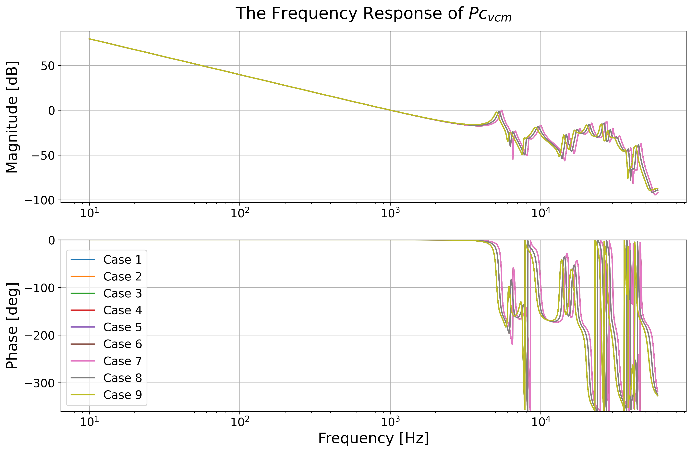
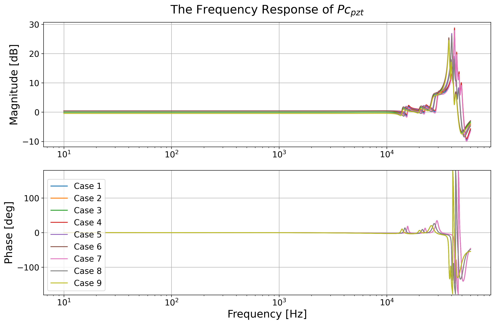
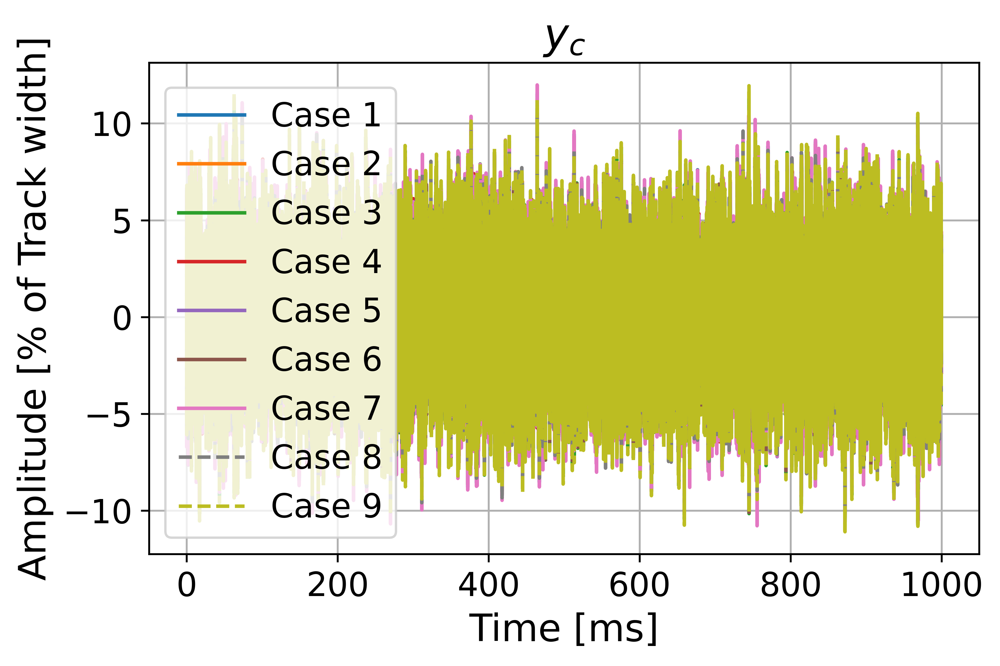
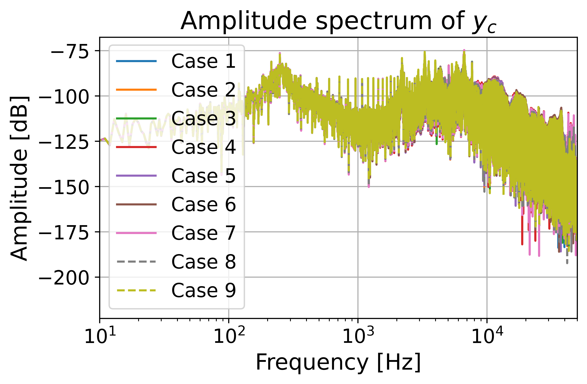
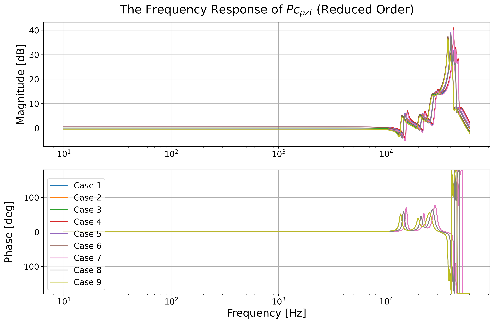
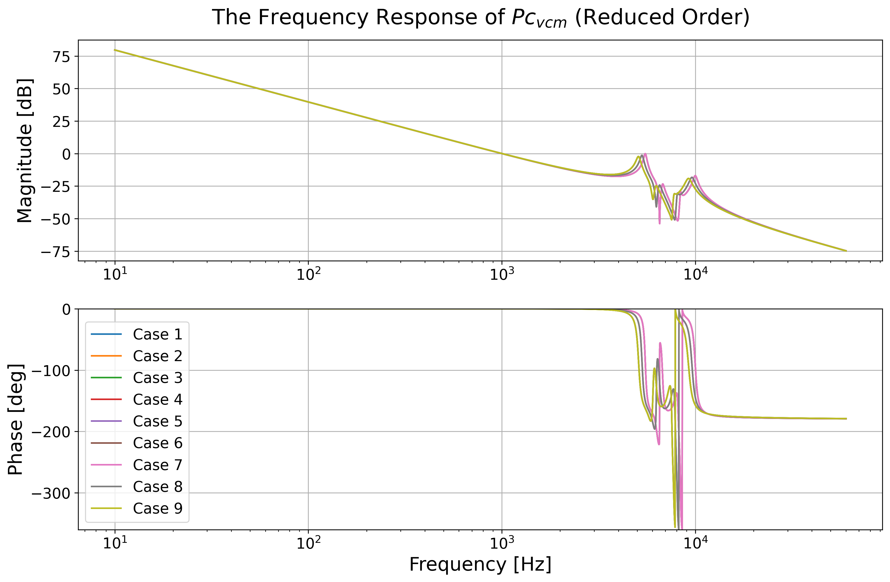

# PyHDD Benchmark: A Python-Based Framework for Precision Motion Control of the Magnetic-Head Positioning Systems in Hard Disk Drives

PyHDD Benchmark is an open-source Python framework for modeling, simulating, analyzing, and designing precision motion control systems for magnetic-head positioning in hard disk drives (HDDs). Building on Takenori Atsumi's MATLAB benchmark, [Magnetic-head Positioning Control System in HDDs](https://www.mathworks.com/matlabcentral/fileexchange/111515-magnetic-head-positioning-control-system-in-hdds), it provides a modular environment for studying dual-stage servo systems that combine a voice coil motor (VCM) for coarse positioning with a piezoelectric (PZT) actuator for fine positioning. The framework supports reproducible control research, controller prototyping, and control-engineering education within Python's open-source scientific computing and machine learning ecosystem.

The framework integrates high-fidelity, multi-resonance actuator models, discrete-time feedback controllers, multi-rate filters, and realistic disturbances from repeatable run-out (RRO), rotational vibration (RV), and cooling fans. Nine benchmark cases cover low, room, and high temperatures together with nominal and ±5% PZT actuator gains, enabling controller evaluation under plant variations. Time- and frequency-domain simulation and visualization tools support the analysis of positioning accuracy, disturbance rejection, and closed-loop behavior. Reduced-order actuator modeling and comparisons with full-order systems provide additional support for controller design and system analysis.

An earlier version of PyHDD Benchmark was presented at the **23rd IFAC World Congress (2026)** in the paper cited below. The current framework expands this foundation with detailed control-design workflows, multi-rate control implementation, and a reinforcement learning (RL) module for automated multi-rate notch-filter design. Using Proximal Policy Optimization (PPO), the RL agent tunes notch filters in the VCM and PZT paths to reduce sensitivity peaks while accounting for waterbed effects and stability-related penalties. Together, these capabilities provide a platform for exploring both conventional and AI-driven approaches to HDD servo control and precision motion control.

**IFAC paper:** Liu, Z., Wan, Y., Lu, R., Santoso, A., Hu, X., Chu, T., Jiang, T., Guo, G., Atsumi, T., Chen, X. “PyHDD Benchmark: A Python-Based Framework for Magnetic-Head Positioning Control Systems in Hard Disk Drives.” In *23rd IFAC World Congress*, 2026.

Authors: Zidong Liu, Yusen Wan, Richard Lu, Amy Santoso, Xiaohai Hu, Thomas Lee Chu, Tianyu Jiang, Guoxiao Guo, Takenori Atsumi, Xu Chen

## Repository Structure

The tree below lists the current top-level files and directories; large figure and cache directories are shown without their contents.

```text
.
├── .gitignore
├── Data_RRO.txt
├── Fre_Resp.json
├── Fre_Resp_reduced.json
├── Paper/
│   ├── Figures/
│   ├── paper.bib
│   └── paper.md
├── README.md
├── RL_config.py
├── RL_multirate_filter.py
├── __pycache__/
├── demo/
│   └── README.md
├── function_simulation.py
├── license.txt
├── plant.py
├── plot_control_system.py
├── plot_result/
├── plot_result_ReducedOrder/
├── print_ASCII.py
├── reduce_order_compare.py
├── reduced_order_system.py
├── requirements.txt
├── requirements_rl.txt
├── simulate_trackfollow.py
├── simulation_result/
│   └── Fre_Resp.json
├── utils.py
└── zpetc.py
```

### Benchmark and Analysis Scripts

- `plant.py`: Defines the VCM and PZT actuator models for nine temperature and gain cases.
- `utils.py`: Provides discrete-time controllers, multi-rate filters, resampling, frequency-response calculations, plotting helpers, and output paths.
- `function_simulation.py`: Runs the nine time-domain simulation cases and saves `res1.pkl` through `res9.pkl` in `simulation_result/`.
- `simulate_trackfollow.py`: Loads the simulation results and plots disturbances, head displacement, amplitude spectra, and positioning-error statistics.
- `plot_control_system.py`: Computes and plots actuator, controller, filter, open-loop, and sensitivity frequency responses.
- `reduced_order_system.py`: Builds reduced-order actuator models, exports their frequency responses, and compares them with full-order benchmark responses.
- `reduce_order_compare.py`: Provides plotting helpers for comparing full-order and reduced-order responses.
- `print_ASCII.py`: Provides the console banner and version-reporting helpers used by the benchmark scripts.
- `zpetc.py`: Contains an experimental zero-phase error tracking compensator example; its inverse-model derivation is currently a placeholder.

### Reinforcement Learning Module

- `RL_multirate_filter.py`: Implements PPO-based notch-filter training, differential-evolution optimization, and optimizer-assisted policy pretraining for the VCM and PZT paths.
- `RL_config.py`: Defines system, training, notch-filter, performance-target, and reward configurations.
- `requirements_rl.txt`: Lists dependencies for the RL and optimization workflows, including PyTorch.

### Data and Output Directories

- `Data_RRO.txt`: Contains the repeatable run-out disturbance data used by the simulations.
- `Fre_Resp.json`: Contains full-order benchmark frequency-response data.
- `Fre_Resp_reduced.json`: Contains reduced-order frequency-response data and is written by `reduced_order_system.py`.
- `simulation_result/`: Contains the full-order `Fre_Resp.json` read by the reduced-order comparison and stores generated time-domain simulation results.
- `plot_result/`: Stores benchmark frequency-response and track-following figures.
- `plot_result_ReducedOrder/`: Stores reduced-order analysis and comparison figures.
- `models/`: Created when running the RL workflows to store model checkpoints, optimized parameters, pretraining datasets, and training histories and figures. This generated directory is ignored by Git.

### Documentation and Supporting Files

- `Paper/`: Contains the paper source, bibliography, and figures.
- `demo/README.md`: Provides additional benchmark parameter and use-case documentation.
- `README.md`: Provides the project overview, repository guide, and usage instructions.
- `requirements.txt`: Lists the pinned dependencies for the baseline benchmark.
- `license.txt`: Contains the project license.
- `.gitignore`: Defines exclusions for generated results, models, and caches.
- `__pycache__/`: Contains Python bytecode caches; these files are not needed to understand or run the source code.

# HDD Benchmark Problem Simulation and Analysis

The organization and content of this repository are inspired by a Matlab reference structure, designed to enhance the navigability and understanding of Hard Disk Drive (HDD) benchmark problem simulations and their analyses.

## Installation and Environment Setup

### Environment Requirements
This project is compatible with Python 3.11.0 and was tested with specific package versions:

- numpy 1.23.4
- control 0.9.4
- scipy 1.11.3
- matplotlib 3.7.0

### Setting Up the Environment

Follow these steps to prepare the environment for running the simulations and analyses:

1. **Clone the repository:**
   - Download the code package and extract its contents.
      ```bash
      git clone https://github.com/macs-lab/PyHDDBenchmark.git
      cd PyHDDBenchmark
      ```

2. **Install Dependencies:**
   - Use pip to install the necessary Python packages:
     ```bash
     pip install -r requirements.txt
     ```

   The console banner also imports `packaging`. For the reduced-order workflow, `reduced_order_system.py` imports `hdf5storage`. These packages are not listed in the baseline requirements file and must be available in the environment.

3. **Install RL dependencies (optional):**
   - To use the notch-filter training and optimization module:
     ```bash
     pip install -r requirements_rl.txt
     ```
   - The RL requirements use version ranges rather than the pinned baseline versions. A separate environment can be used for RL experiments.

## Running the Project

Run the following commands from the repository root so that relative data and output paths resolve correctly.

### Time-Domain Simulation and Track-Following Plots

First generate the simulation results, then plot them:

```bash
python function_simulation.py
python simulate_trackfollow.py
```

The simulation launches nine cases and may take several minutes. `simulate_trackfollow.py` reads the resulting `simulation_result/res1.pkl` through `res9.pkl` files.

### Frequency-Domain Analysis

Compute and plot the benchmark frequency responses:

```bash
python plot_control_system.py
```

This workflow uses the plant and controller models directly and does not require the time-domain simulation results.

### Reduced-Order Analysis

Compare the reduced-order actuator models with the full-order benchmark:

```bash
python reduced_order_system.py
```

The script reads `simulation_result/Fre_Resp.json`, writes `Fre_Resp_reduced.json` in the repository root, and saves figures in `plot_result_ReducedOrder/`.

### RL and Optimization Workflows

After installing `requirements_rl.txt`, train a PPO notch-filter policy:

```bash
python RL_multirate_filter.py --mode train
```

Alternatively, optimize notch parameters using differential evolution for the nominal room-temperature case (`c2`), or pretrain a policy using optimizer-generated examples:

```bash
python RL_multirate_filter.py --mode optimize --plant-case c2
python RL_multirate_filter.py --mode pretrain
```

Run `python RL_multirate_filter.py --help` for training limits, optimizer settings, and warm-start options. Configure system and training parameters in `RL_config.py`.

## Output Locations

| Workflow | Output location |
| --- | --- |
| Time-domain simulation | `simulation_result/res1.pkl` through `res9.pkl` |
| Benchmark frequency-response and track-following plots | `plot_result/` |
| Reduced-order frequency-response data | `Fre_Resp_reduced.json` in the repository root |
| Reduced-order plots | `plot_result_ReducedOrder/` |
| RL training, optimization, and pretraining artifacts | `models/` |

The standard plot and simulation-cache paths are defined in `utils.py`. The reduced-order and RL scripts define their own output paths.

## Key Features

1. **Multi-resonance high-precision actuator models:**
   - Detailed Voice Coil Motor (VCM) and Piezoelectric (PZT) actuator models
      <br />
      <div align="center">
      
      </div>
      <div align="center">
      
      </div>
   - Captures multiple resonance modes for accurate system representation

   - Efficient time- and frequency- domain analysis
      <center class="half">
       
      </center>
   
   - Based on [Horowitz et al. (2007)](https://doi.org/10.1016/j.conengprac.2006.09.003)

2. **Rich disturbance modeling:**
   - Repeatable Run-Out (RRO): Oscillation of target tracks on the disk
      <br />
      <div align="center">
      
      </div>
   - Rotational Vibration (RV): External vibration from other HDDs
      <br />
      <div align="center">
      
      </div>
   - Fan-induced Vibration: Vibration caused by cooling fans
      <br />
      <div align="center">
      
      </div>
   - Disturbance models based on [Guo and Zhang (2003)](https://doi.org/10.1109/TMAG.2003.814287)

3. **Decoupled sensitivity loop shaping:**
   - Implements the decoupled sensitivity design approach
      <br />
      <div align="center">
      
      </div>  
   - Allows separate controller design for VCM and PZT stages
   - Based on [Li and Horowitz (2001)](https://doi.org/10.1109/3516.928724)

4. **Temperature and gain variation modeling:**
   - Nine pre-configured cases for different operational conditions
   - Temperature variations: Low, Room, and High temperatures
   - PZT actuator gain variations: Nominal, +5%, and -5%
   - Based on [Atsumi et al. (2019)](https://doi.org/10.1109/TIE.2019.2955432)
      | Case No. |    1    |    2    |    3    |     4      |     5      |     6      |     7      |     8      |     9      |
      | :------: | :-----: | :-----: | :-----: | :--------: | :--------: | :--------: | :--------: | :--------: | :--------: |
      |  Temp.   |   LT    |   RT    |   HT    |     LT     |     RT     |     HT     |     LT     |     RT     |     HT     |
      | PZT gain | Nominal | Nominal | Nominal | Nominal+5% | Nominal+5% | Nominal+5% | Nominal-5% | Nominal-5% | Nominal-5% |

5. **Reduced-order modeling:**
   - Tools for creating and analyzing reduced-order system models
      <br />
      <div align="center">
      
      </div>
      <div align="center">
      
      </div> 
   - Useful for control design and system analysis
   - Inspired by [Boettcher et al. (2010)](https://doi.org/10.1299/jamdsm.4.107)

## Contact

For questions or feedback, please contact chx@uw.edu
